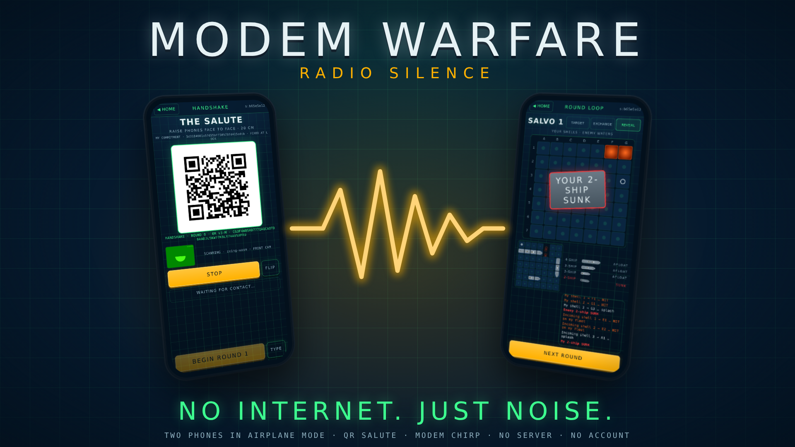

# Modem Warfare — Radio Silence

**Two phones in airplane mode fight a naval war by screaming dial-up noise at
each other.**

A two-player hidden-fleet duel for phones that have nothing: no internet, no
Wi-Fi, no Bluetooth, no server, no account. Place a fleet of four ships on a
7×7 board, shake hands with a QR salute, and fight in simultaneous three-shot
salvo rounds. Every move crosses the table as a single static QR code (the
Lamp) or as an audible modem chirp (the Sonar). Neither phone can cheat: each
fleet is committed under a salted hash before the first shot, and when the
last ship sinks both phones reveal and audit every round. The end screen
stamps the match **VERIFIED — NO SHIP MOVED**, or names the lie.

Built solo in one week for Hackyard Yard #6 ("Offline").



## Play it

**https://marlandoj.github.io/modem-warfare/app/**

You need two phones and a table. Every real-phone test so far was on two
Android phones; an iPhone should work (the app uses only standard web APIs)
but has not been tested as of this build.

### Install on a phone (once, while online)

1. Open the play URL in the phone's browser. Wait for the badge at the bottom
   of Home to read **OFFLINE READY ✓ 25/25 CACHED**. That is the app telling
   you every file it will ever need is on the phone.
2. Add it to the home screen: Android Chrome → menu → **Add to Home screen**;
   iPhone Safari → share sheet → **Add to Home Screen**.
3. Switch on airplane mode. Launch from the icon. The badge still reads READY.
   It will never ask for the network again.

Do the same on the second phone. Camera and microphone are only ever asked
for on the screens that use them.

### Start a match

1. **Pick the transport on Home.** TRANSPORT: **CHIRP** (phones flat on the
   table, speaker toward mic) or **QR** (phones held face to face, about 20
   cm). It is set before the match; the host's choice rides the handshake and
   the joining phone adopts it, so both phones always play the same carrier.
   Beside it, **MUSIC** switches the score on or off (on by default; it
   never plays over a chirp or an open microphone, see below).
2. One phone taps **NEW MATCH**, the other **JOIN MATCH**. Both place a fleet
   (tap a ship to rotate, REROLL for a new layout) and tap **LOCK**. LOCK is
   the moment your fleet is sealed: the phone draws a random salt and fixes
   the commitment hash. Nothing can be moved after this.
3. **The Salute.** By chirp: the guest's phone is already listening; the host
   taps **CHIRP**; the guest's phone hears it, adopts the session and shows
   its own frame; the guest taps **CHIRP** back. By QR: the host shows its
   handshake code, the guest taps **SCAN** and points the front camera at it,
   then shows its own code for the host to scan. Each phone now holds the
   other's commitment. Both tap **BEGIN ROUND 1**.
4. **Salvo rounds.** Pick three targets and tap **FIRE**. Exchange over the
   one carrier (chirp or scan) until both phones show **CONTACT**, then tap
   **REVEAL**: your shells land first (splash, splash, HIT, a ship sinks cell
   by cell), then theirs on your fleet. **NEXT ROUND** until one fleet's four
   ships are sunk. A match runs about six to twelve rounds.
5. **The audit stamp.** At game over both phones exchange a reveal frame
   (fleet plus salt) over the same carrier. Each phone recomputes the other's
   commitment and replays every reported HIT, miss and SUNK against the
   revealed fleet. Then the stamp lands:
   - **VERIFIED — NO SHIP MOVED**: the revealed fleet hashes to the
     commitment fixed at LOCK and every result the opponent reported was
     true.
   - **LIAR**: something does not add up, and the stamp says what — the
     fleet does not match the commitment (a ship moved, or the salt is
     wrong), or a result was reported falsely (named by round and cell).
   - A player who refuses to reveal forfeits; the other phone claims it with
     two taps.

If a scan or a chirp fails, just do it again: the receiving gate treats a
repeated frame as a no-op and an older frame as "their phone is a step
behind", so game state can never fork. **RESEND** re-shows the previous
frame; **TYPE** lets you paste the other phone's frame text by hand if a
camera or microphone is unusable.

## Technical notes

- **No server, no account, no network after install.** The app is static
  HTML, CSS and JavaScript with a hand-written precache service worker (25
  files, cache `mw-final-v3`). The content-security policy allows `'self'`
  only; nothing in the app can contact a network at runtime, and the
  browser-gate suite proves a cold launch with the server gone.
- **The fleet is drawn in code.** Every ship is top-down inline SVG from
  `app/js/ships.js`, one segment per cell (bow, midships, stern) in four
  classes (battleship, cruiser, destroyer, corvette), recoloured by the
  stylesheet for hits and wrecks. No image asset is loaded for it.
- **The fleet commitment is a salted hash.** At LOCK the phone draws a
  128-bit random salt and commits to the first 16 bytes of SHA-256 of
  (fleet ‖ salt), using a vendored SHA-256 so it works in any context. The
  salt is mandatory: a 7×7 fleet space is small enough to brute-force
  unsalted. The salt is revealed only at game over, inside the reveal frame.
- **The frame is the source of truth on either carrier.** A salvo is a
  12-byte frame (type, session, round, three target cells, results, sunk
  flags, check byte), base32-encoded. The QR carries that text; the chirp
  carries the same text. A decoded chirp goes through exactly the same
  receive gate as a scan, so the audit is the same whichever carrier moved
  the frame, and a bad decode can only ever cost a re-send.
- **The Sonar** is ggwave's audible FAST protocol (about 2 s of chirp for a
  salvo, 3.5 s for a handshake), played through the speaker and captured by
  an AudioWorklet with echo cancellation, noise suppression and gain control
  off. Measured on two real Android phones at a metre on 2026-11-02: 10 of
  10 chirps decoded.
- **The Lamp** is a QR version 2–3 at error-correction M, decoded by the
  browser's BarcodeDetector where it exists and by a bundled zxing-wasm
  elsewhere.
- **The score** is an original wartime soundtrack, synthesised at play time
  like every other sound here: a ceremonial naval march (brass, snare,
  timpani, 104 bpm) fused with 1980s carrier-deck rock (pulsing arpeggios,
  octave bass, a soaring lead). Home plays the theme, placement a quiet
  chart-room march, the Salute and the rounds a tension ostinato that gains
  a layer on the first hit and its lead line in the final rounds; victory
  brings a fanfare and the theme back at strength, defeat a short brass
  descent. It is code (`app/js/music.js`, about 34 KB, in the precache); no
  audio file ships. It starts on the first tap, and it ducks to exactly zero
  gain for every Sonar listen window and every chirp the phone sends, so it
  costs the acoustic path nothing. MUSIC on Home switches it; the sound flag
  below is its master. See `docs/SOUNDTRACK-REPORT.md`.
- **The sound flag.** `app/js/config.js`, line 17: `export const SOUND =
  true;`. Set it to `false` and every sound affordance leaves the interface
  at boot, the score included; the match plays by QR alone. The suite plays
  a whole match both ways.

## Repository layout

```
app/        the product — vanilla HTML/CSS/JS, no framework, no build step
  sw.js     precache service worker (explicit list; bump VERSION on change)
  js/config.js  the build switches: SOUND, one line
  js/frame.js   frame codec + receive gate (also runs under Node for tests)
  js/sha256.js  vendored SHA-256 for the fleet commitment
  js/audit.js   end-of-game audit: commitment + every reported result vs the reveal
  js/audio.js   WebAudio feel: lamp clack, contact bell, fire, splash, hit, horn, stamp
  js/music.js   the score: notation, the five scenes, the synthesised instruments, the scheduler, the duck
  js/sonar.js   the Sonar engine: ggwave chirp send, AudioWorklet capture, decode → gate
  js/qr.js      QR render (qrcode-generator) and decode (BarcodeDetector → zxing-wasm)
  vendor/   every third-party file the app loads (see vendor/VENDOR.md)
dev/        two-window harness — dev tool, not precached
spike/      ggwave Sonar spike page — dev tool, not precached
tests/      node --test unit tests + Playwright browser gates
tools/      zero-dependency static server, icon rasteriser, ggwave patch tool, gallery tool
screenshots/  the shipped build's real screens (see docs/SHIP-REPORT.md)
campaign/   the build week's task manifests
docs/       the daily reports, the ship report, the removal record, the soundtrack report and their evidence
```

## Run it locally

```sh
node tools/serve.js 8080                  # http://127.0.0.1:8080/app/
node tools/serve.js 8080 --bind 0.0.0.0   # reachable from phones on the LAN
```

- App: `http://<host>:8080/app/`. Camera and microphone need a secure
  context (`localhost` or `https`); on a LAN, Chrome on Android can be told
  to trust the laptop's origin via
  `chrome://flags/#unsafely-treat-insecure-origin-as-secure`.
- Dev harness: `http://<host>:8080/dev/harness.html` — two app instances
  side by side; **Run full match (QR)**, **Run full match (chirp)**, **Run
  match, B lies**, **Run chirp loopback**, or drive them by hand.
- ggwave spike: `http://<host>:8080/spike/` — the acoustic send / receive
  test page with honest counters.

## Test it

```sh
npm run test:unit                     # node --test, no dependencies: codec, sha256, audit, removal (string scan), the score
npm install && npx playwright install chromium
npm run test:browser                  # shell, QR pixels, cold offline launch, harness, removal, full match + cheats,
                                      # spike, sonar, soundflag, transport, viewport, soundtrack
npm test                              # both; the trusted check in .verity.json (about 3 minutes in 4 lanes;
                                      # MW_LANES=1 runs the browser gates one after another, about 9 minutes)
node tools/gallery.js                 # after npm test: rebuilds thumbnail.png and screenshots/ from the gate evidence
```

The browser runner finds Chromium in `$PLAYWRIGHT_BROWSERS_PATH`, else a
repo-local `.browsers/`, else beside the `node_modules` that holds
playwright, else Playwright's default cache. Headless Chromium has no real
microphone, so the acoustic path is proven on phones, not in the suite; the
suite proves everything else, including a whole match carried by chirp
waveforms through the production capture pipeline.

## Claims discipline

Say: no internet, no Wi-Fi, no Bluetooth, no server, no account; install
once, then never again; cheating is provable — the end-of-game stamp is
real. Never say "secure" or "encrypted" about the app, "unhackable", or
"provably fair" as a slogan. The shell gate asserts that the words secure
and encrypted appear nowhere in the app's copy.

## Licences

Code: MIT. Vendored: qrcode-generator (MIT), zxing-wasm (MIT, over zxing-cpp
Apache-2.0), ggwave (MIT). "QR Code" is a registered trademark of DENSO WAVE.
